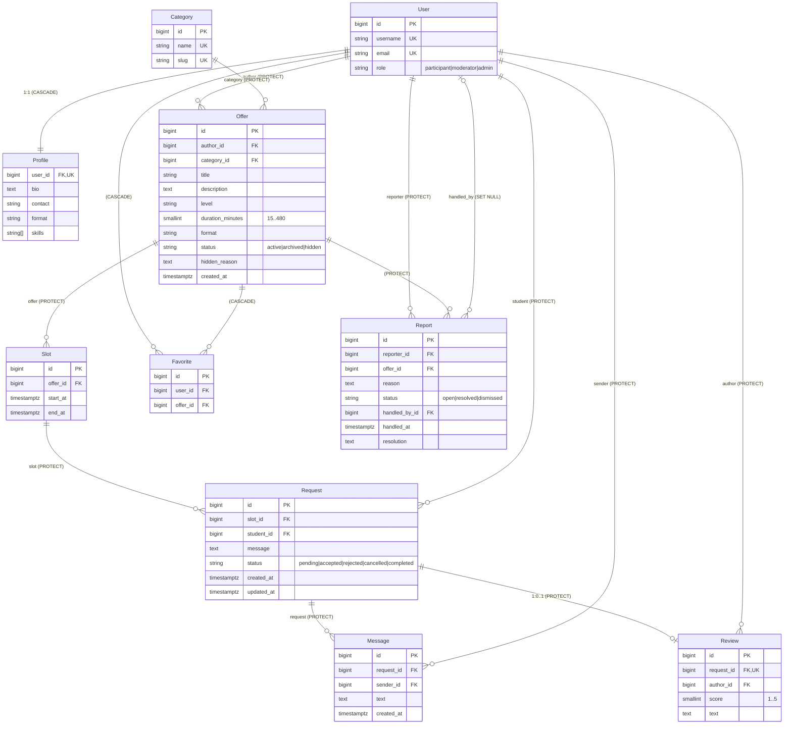

# ER-диаграмма и обоснование изменений модели

## Ограничения, закреплённые в БД

| Правило | Как реализовано |
|---|---|
| У слота не более одной принятой/завершённой заявки | частичный `UNIQUE (slot_id) WHERE status IN ('accepted','completed')` |
| Нет повторной действующей заявки ученика на слот | частичный `UNIQUE (slot_id, student_id) WHERE status IN ('pending','accepted','completed')` |
| Один отзыв на встречу | `UNIQUE (request_id)` (OneToOne) |
| Оценка 1–5 | `CHECK (score BETWEEN 1 AND 5)` |
| Слот заканчивается после начала | `CHECK (end_at > start_at)` |
| Нет двух слотов с одним началом у предложения | `UNIQUE (offer_id, start_at)` |
| Одно предложение — одна запись в избранном у пользователя | `UNIQUE (user_id, offer_id)` |
| Одна открытая жалоба от автора на предложение | частичный `UNIQUE (reporter_id, offer_id) WHERE status='open'` |

Частичный индекс на слот — «последний рубеж» против гонок. Основная защита: `SELECT ... FOR UPDATE` по слоту в транзакции принятия (`services.accept_request`).

## Индексы

Внешние ключи индексируются автоматически (Django). Дополнительно: `Offer(status, category, level, format)` — основной запрос каталога; `Offer(status, -created_at)` — сортировка; `Offer(author, status)` — «Мои предложения»; `Slot(start_at)`; `Request(student, status)`, `Request(slot, status)`; `Message(request, created_at)`; `Report(status, -created_at)`.

## Отличия от предложенной модели (для защиты)

1. **`User.role`** — три роли (участник / модератор / администратор) хранятся в пользователе; API роль не принимает, меняет только суперпользователь в `/admin/`.
2. **`Offer.status`** = `active | archived | hidden` + **`hidden_reason`**: архивирование автором и скрытие модератором — разные состояния; причина скрытия обязательна.
3. **`Offer.duration_minutes`** вместо абстрактного `duration` — единица измерения в названии, диапазон 15–480 мин проверяется.
4. **`Profile.skills`** — JSON-массив строк: навыки — простой список без собственных атрибутов; `JSONField` работает и в SQLite для локальной разработки, и в PostgreSQL при необходимости. Если понадобится поиск по навыкам со статистикой — вынести в `Skill` + M2M.
5. **`Request.updated_at`** — для отображения и разбора спорных ситуаций.
6. **`Report`**: добавлены `handled_by`, `handled_at`, `resolution` — журнал решений модератора.
7. **Удаление**: везде `PROTECT` (история встреч не должна исчезать каскадно, предложения архивируются, а не удаляются). Исключения с обоснованием: `Profile` (1:1, не имеет смысла без пользователя) и `Favorite` (личная закладка, не история).
8. **Отмена слота освобождает его**: статус `cancelled` не входит в условие частичного индекса, поэтому после отмены на слот снова можно записаться.
